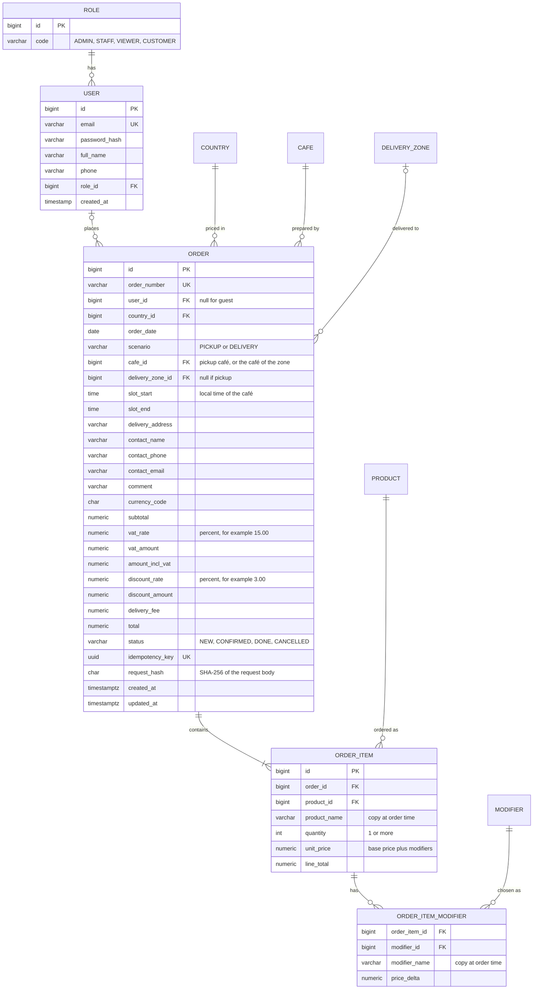
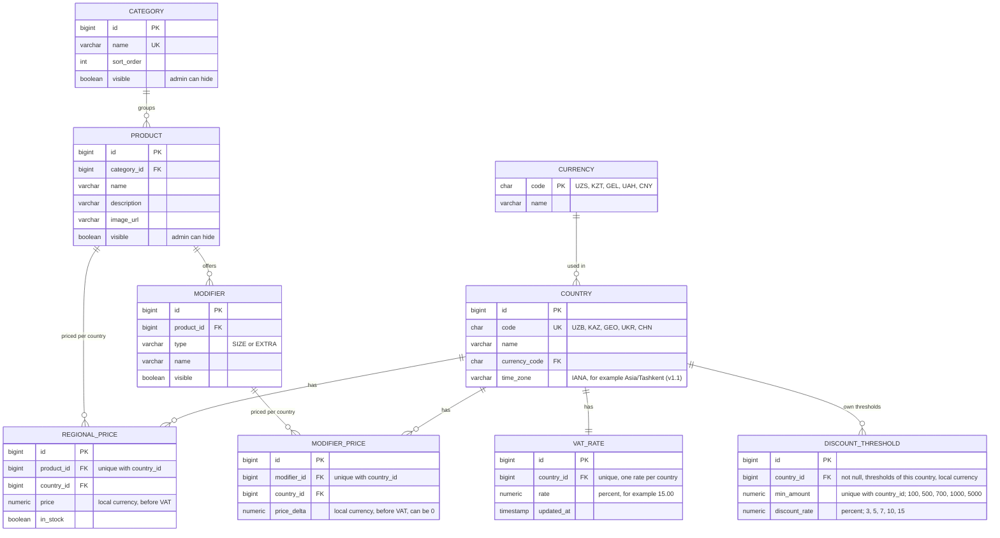
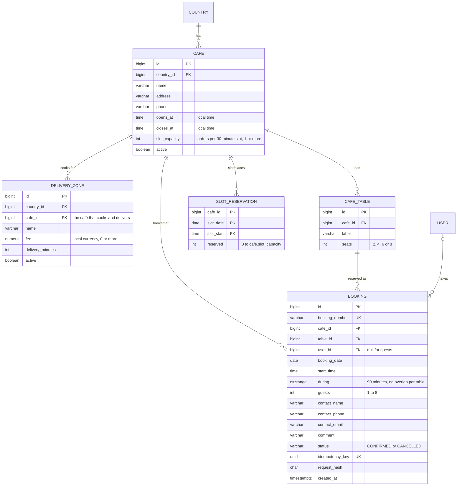

# Backend ERD

One data model for the whole backend. Refs #19.
Each backend developer adds the tables of their part to this file.

| Part | Owner | Status |
|---|---|---|
| Users, roles, orders | Nodir, Timur | v1.1 (#134, #144) |
| Country, currency, VAT, discounts, catalog, pricing | Abdulaziz, Timur | draft |
| Cafés, delivery zones, time slots, booking | Abdulaziz | v1.1 (#143, #174) |

## Users, roles, orders

## Why it looks like this

1. One role per user. The plan has four roles and nobody needs two at once, so `role_id` in `user` is enough. RBAC (#65) reads it from the JWT.
2. `user_id` in `order` can be empty, so a guest can order without an account. Order history (#63) shows orders where `user_id` is the logged-in user.
3. The order keeps every step of the price formula (subtotal, VAT, discount, delivery fee, total) and the currency. Reports (#66, #67, #68) then sum saved numbers and do not recalculate old orders after a price or VAT change.
4. Product and modifier names are copied into the order. If the admin renames or deletes a dish, old orders and reports still show the right name.
5. All money is `numeric(12,2)`, in Java `BigDecimal`, as the plan says.

## Country, currency, VAT, discounts, catalog, pricing

Links to the first part: `order.country_id` → `country`, `order.currency_code` → `currency.code`, `order_item.product_id` → `product`, `order_item_modifier.modifier_id` → `modifier`.

### Why it looks like this

1. Country codes are UZB, KAZ, GEO, UKR, CHN, as in #50 and the seed data (#33). Currency is its own table with the ISO code as the key, so `order.currency_code` points to it and the countries API returns the currency together with the VAT rate.
2. Regional price is one row per product and country. The price is before VAT, because the formula starts from Subtotal and adds VAT on top (#55). No row means the dish is not sold in that country.
3. Stock is the `in_stock` flag in `regional_price`. The stories only need "in stock / out of stock" (#51, #64), and the menu already reads this row. If we need quantities later, we move it to its own table.
4. Modifier prices are per country for the same reason as product prices: one number cannot be right in UZS and in CNY. Unit price = regional price + sum of chosen `price_delta` (#52). The order copies `price_delta`, so later price changes do not touch old orders.
5. VAT and discount thresholds are tables, not code. The pricing service (#34) reads them, and the admin can change them without a new release. Thresholds are per country and in the local currency: every country has its own 5 rows with the same numbers (100 / 500 / 700 / 1000 / 5000), with no conversion (Decision Log, 5 Nov). Discount rate = the row with the biggest `min_amount` that is not more than Amount incl. VAT. Below 100 there is no row, so no discount (#55). The formula and rounding rules are in `docs/pricing.md`.
6. Category, product and modifier have `visible`. The admin hides them instead of deleting (#64), so old orders keep working.
7. Money is `numeric(12,2)` like in the first part. Rates are `numeric(5,2)` in percent (`15.00`, not `0.15`), in the tables, in the order and in the API.

## Cafés, delivery zones, time slots, booking (v1.1)

Agreed in `docs/api-contract.md` v1.1 (§3.6–3.10). Migrations: #143 (cafés, zones, tables, slot places), #174 (booking).

### Why it looks like this

1. One `cafe` for pickup, delivery and booking: the guest picks it for pickup, a zone points to it for delivery, and booking uses its tables. Opening hours live in one place.
2. Slots are not rows per day. The list is calculated from `opens_at` and `closes_at`, and only taken places are stored in `slot_reservation`. Taking a place is one atomic `INSERT … ON CONFLICT … WHERE reserved < capacity` (api-contract.md §3.8), so two guests can never both get the last place.
3. The order keeps `cafe_id` for both scenarios (the kitchen), `delivery_zone_id` only for delivery, and the slot as `slot_start` and `slot_end` local times, not as a foreign key.
4. A table can never be booked twice for overlapping times: `EXCLUDE USING gist (table_id WITH =, during WITH &&)` for confirmed bookings (`btree_gist`).
5. `idempotency_key` is unique in `customer_order` and `booking`, so a retry returns the first result instead of a second row.
6. Admin edits use optimistic locking: `product`, `category` and `regional_price` get `version int not null default 0` (api-contract.md §3.15).
7. `country.time_zone` (IANA name) gives "today" and "now" for each country.

## Open questions for the team

1. ~~Do we keep `vat_rate` and `discount_rate` in the order, or only the amounts?~~ Closed: keep both rates and amounts (`docs/pricing.md`, #34).
2. ~~Order status list: is NEW, CONFIRMED, DONE, CANCELLED enough?~~ Closed: yes. Staff change it; CANCELLED frees the slot place (api-contract.md v1.1, §3.14).
3. ~~Booking (table reservation): is it linked to `user`, or guests can book too?~~ Closed: guests can book; `user_id` is set when the guest is logged in (api-contract.md v1.1, §3.10).
4. ~~Discount thresholds: local currency or one base currency (#44)?~~ Closed: local currency of each country, the same numbers (100 / 500 / 700 / 1000 / 5000), no conversion, 5 rows per country. See the Decision Log, 5 Nov.
5. ~~Rates: percent (15.00) or fraction (0.15)?~~ Closed: percent everywhere, including `order.vat_rate` and `order.discount_rate` (`docs/pricing.md`, #34).
6. Stock: one flag per country (as here) or one flag for all countries?
7. Modifiers: per dish (as here), or shared between dishes, for example one "Extra cheese" for all?